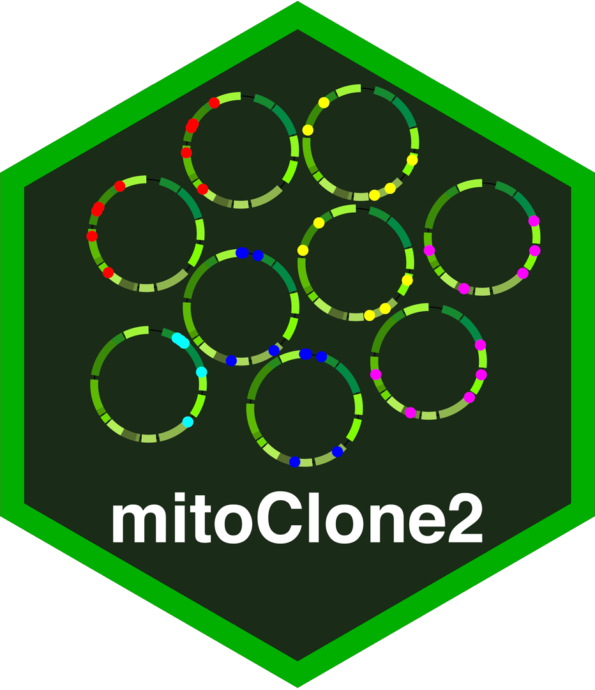

# mitoClone2 

The R package is used for performing the analysis of clonal heterogeneity based on nuclear and mitochondrial mutations in single cell RNA or DNA sequencing.

You can read about the package and explore an extensive vignette in the supplemental section of our accompanying publication:

**Story B**, **Velten L**, **Mönke G**, **Annan A**, **Steinmetz L**. Mitoclone2: an R package for elucidating clonal structure in single-cell RNA-sequencing data using mitochondrial variants. *NAR Genomics and Bioinformatics*. 2024;6(3):lqae095. Published 2024 Aug 9. [doi:10.1093/nargab/lqae095](https://doi.org/10.1093/nargab/lqae095)


## 1. System Requirements:
   - Linux/Mac/Windows
   - R 4.4+
   - GNU make and a C++ compiler (the package contains compiled code)
   - the compression libraries zlib, bzip2 (libbz2) and xz (liblzma) and libcurl, needed by htslib (via the Rhtslib package) to read BAM files, see **Installation**
   - SCITE/PhISCS (included)
   - Python 2.7, 3.6, or 3.7 (optional)
   
Importantly, depending on the user's need for tree-building, an installation of PhiSCS may be necessary. For SCITE, the program should be installed automatically when the mitoClone2 package is installed. Please read the manual provided by the software authors [SCITE Installation Instructions](https://github.com/cbg-ethz/SCITE) to better understand the software.

See **DESCRIPTION** file for specific R package requirements.

The software has been successfully implemented and tested using: Python 3.6.5, R 4.0.0, and on Ubuntu 18.04, CentOS 7, macOS 14.5, and Windows 11.

## 2. Installation

### System libraries (Linux)
On Linux the libraries that htslib needs to read BAM files have to be installed before the R package. If they are missing, the installation of Rhtslib or mitoClone2 fails with errors such as `lzma.h: No such file or directory`, `bzlib.h: No such file or directory` or `cannot find -llzma`.

Debian / Ubuntu:
``` bash
sudo apt-get install build-essential zlib1g-dev libbz2-dev liblzma-dev libcurl4-openssl-dev
```

Fedora / CentOS / RHEL:
``` bash
sudo dnf install gcc-c++ make zlib-devel bzip2-devel xz-devel libcurl-devel
```

conda (if R is installed with conda):
``` bash
conda install -c conda-forge zlib bzip2 xz libcurl
```

macOS: the binary packages from Bioconductor do not need any additional libraries. To compile from source the Xcode command line tools are required (`xcode-select --install`).

Windows: the binary packages from Bioconductor do not need any additional libraries. To compile from source [Rtools](https://cran.r-project.org/bin/windows/Rtools/) is required.

### R package
For manual package installation use the command:

``` r
## install via Bioconductor
if (!requireNamespace("BiocManager", quietly = TRUE))
    install.packages("BiocManager")
BiocManager::install('mitoClone2')
## use devtools to install
##devtools::install_github("benstory/mitoClone2")

```

Estimated installation time: < 1 hour*

## 3. Demo

Please see R vignettes for further instructions and a demo using real data. Use the command `vignette("mitoClone2")` after loading the library (see Instructions) to list all available tutorials.

Estimated demo completion time: < 1 hour

## 4. Usage Instructions

After installing all dependencies, open an R session and load the library using the following command:

``` r
library(mitoClone2)
```

*Notes:*
Please make sure to set your environmental python variables correctly for use of gurobi. See for example the `python_env` parameter.

Again please view the R vignettes for usage possibilities.

   - **overview**: Instructions on how to filter mitochondrial mutations using either a list of sites to be excluded or shared mutations across samples/patients (typical runtime: > 10 minutes)
   - **clustering**: Instructions on how to cluster mutations into a clonal hierarchy and how to assign cells to clones (typical runtime: < 1 hour)
   - **sparse10x**: Reading large 10x Genomics datasets into sparse matrices with `bam2R_v2`, calling variants on the mitochondrial genome and on nuclear sites, checking strand bias and plotting the results (typical runtime: < 5 minutes)


